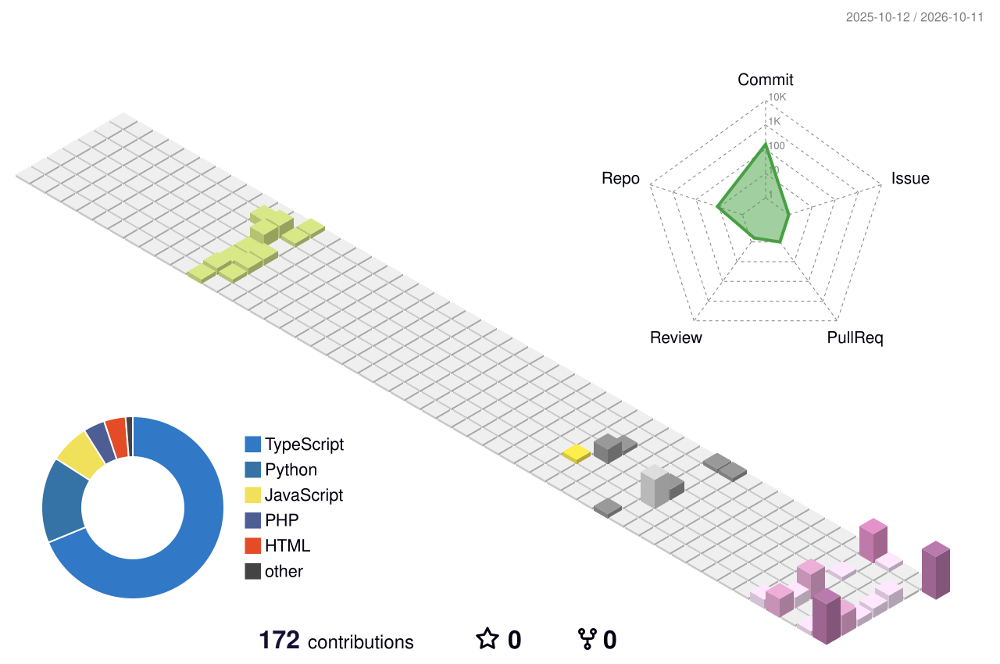

---

## 🚀 About Me

- 💻 Learning **full-stack development**
- 🌱 Currently exploring **JavaScript, Python, PHP**
- 🎯 Building portfolio projects (calculator, inventory, web design)
- ⚡ Fun fact: I love turning ideas into real apps

---

## 🛠️ Tech Stack

---

## 📊 GitHub Stats

 

 

---

## 🐍 3D Contribution Calendar

---

## 📫 Connect with Me

