 

<table>
<tr>
<td valign="top"></td>
<td valign="top"></td>
</tr>
</table>

## Ogi Bastian

**Full-Stack Development Learner · JavaScript · Python · PHP**

 

<!-- animated contribution graph, refreshed daily by the workflow -->

---

## 🚀 About Me

- 💻 Learning **full-stack development**
- 🌱 Currently exploring **JavaScript, Python, PHP**
- 🎯 Building portfolio projects (LMS — contributing to someone else's repo, Sawmoto, Parfum-website, Chatbot-app)
- ⚡ Fun fact: I love turning ideas into real apps

---

## 🛠️ Tech Stack

---

## 🚀 Featured Projects

| Project | Stack | Deskripsi |
| :--- | :--- | :--- |
| [**SAWmoto**](https://github.com/bastiandev9-dotcom/SAWmoto) | TypeScript | Aplikasi rekomendasi kendaraan pakai metode Simple Additive Weighting (SAW). |
| [**Parfum-website**](https://github.com/bastiandev9-dotcom/Parfum-website) | PHP | Website katalog dan profil produk parfum. |
| [**chatbot-app**](https://github.com/bastiandev9-dotcom/chatbot-app) | Python | Aplikasi chatbot sederhana. |
| [**LMS**](https://github.com/bastiandev9-dotcom/LMS) | TypeScript | Project rekayasa perangkat lunak — kontribusi di repo orang lain. |

---

## 📊 GitHub Stats

 

 

---

## 📫 Connect with Me

